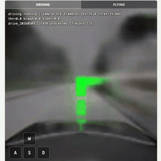
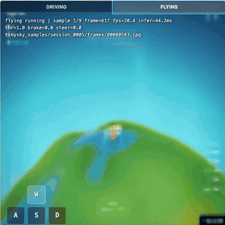
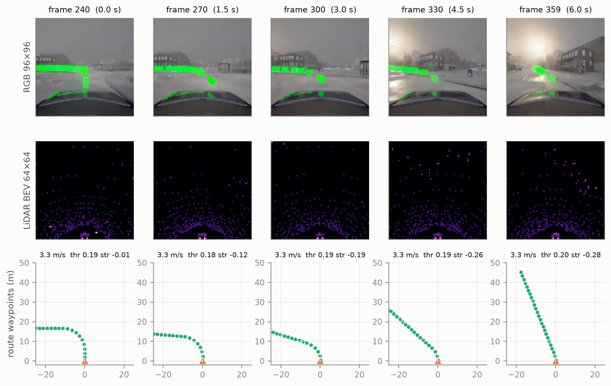
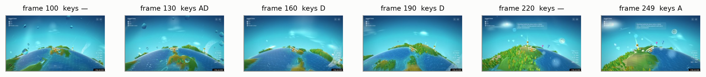

# Neural Simulator: Lightweight World Models for Continuous Interactive Environments

<p align="center">
  
  &nbsp;
  
</p>
<p align="center"><em>Every frame above is generated by a small neural network running in the browser. Neither CARLA nor the TinySkies game is running.</em></p>

<p align="center">
  <a href="https://drift-sim-production.up.railway.app/"><b>▶️ Play it in your browser</b></a> &nbsp;·&nbsp;
  <a href="paper/"><b>📄 Paper</b></a> &nbsp;·&nbsp;
  <a href="results/rollout_eval.ipynb"><b>📈 Evaluation</b></a> &nbsp;·&nbsp;
  <a href="results/latency.ipynb"><b>⏱️ Size &amp; speed</b></a> &nbsp;·&nbsp;
  <a href="artifacts/"><b>🧠 Models (ONNX / Keras)</b></a>
</p>

This project asks whether **small learned world models can stand in for an interactive environment**. The test is not a good next-frame prediction. It is whether the model keeps working when it has to consume its own predictions indefinitely while a human is at the controls.

We train two compact, action-conditioned transition models:

| | **CARLA driving** | **TinySkies flight** |
|---|---|---|
| Learns from | 3.3 h of CARLA autopilot driving (RGB, LiDAR, telemetry, route) | 1.25 h of screen recordings of a browser flight game + keyboard |
| Predicts | next RGB frame **and** structured state: telemetry (speed, acceleration, velocity), route waypoints, a LiDAR latent | next frame, via a 6×6×64 VAE latent |
| Model | one-step Markov CNN + MLP, **1.58 M params, 6.4 MB** | VAE + 2-layer GRU latent dynamics, **3.79 M params, 15.2 MB** |
| Runs | in the browser (onnxruntime-web, WASM) or locally (`play.py`) | same |

At inference the original simulator is gone. A person presses keys, the model predicts the next state, the prediction becomes the next input, and so on. The deployed demo sustains this at up to 30 frames per second on a laptop CPU.

**Next-state prediction is the training problem. Sustained neural simulation is the research problem.** The browser makes the second one directly testable: you can accelerate, steer, reset, and see where the learned environment holds up and where it breaks.

---

## Findings at a glance

These are measured on the released models unless marked *(observed)*. Full numbers are in [`results/rollout_eval.ipynb`](results/rollout_eval.ipynb) and the paper.

- **Behaviour survives where pixels don't.** CARLA frames lose fine detail from the very first step: predicted frames keep about ⅓ of the real frames' high-frequency detail, and that stays flat over the horizon. On a held-out recording, predicted speed nevertheless tracks the real speed to within ≈1.3 m/s after 5 s of free rollout. The model does not reconstruct detail and then lose it; it never reconstructs it.
- **The structured state is its own small dynamics model.** In the CARLA model, speed, route and momentum evolve in an MLP that never sees the image. The image is rendered *conditioned on* that state. That is why momentum persists while pixels blur.
- **Momentum is learned as an integrator with little damping.** Moderate inputs give stable speeds. Real autopilot control sequences, replayed open-loop for 100 s, keep all six seeds bounded and moving. But sustained heavy throttle (a held key, or a control stream from faster driving) pushes predicted speed far beyond anything in the data and then into a visual collapse. A human, or a simple controller reading the model's own predicted speed, closes that loop and keeps rollouts bounded.
- **Turning is harder than going straight** for CARLA's structured state (speed and waypoint error 1.6–1.9× higher while turning). The data is 89% straight driving.
- **LiDAR is encoded but not propagated.** The seed scan's 64-d latent does contain LiDAR information: linear probes recover occupancy and left/right structure with R² ≈ 0.8. But the information is squeezed into ≈0.2% of the latent's range. The predicted next latent does not track the true one (correlation ≈ 0.03 one step ahead), and the other outputs barely react to it. The training LiDAR loss looked near zero because the target varies so little that a constant guess scores 8e-6. Telemetry and route waypoints are the non-visual state the model actually uses.
- **TinySkies learns flight dynamics in latent space.** Latent error stays below a hold-still baseline for the full 64-step horizon. Terrain keeps evolving coherently under the player's inputs for a few hundred steps, and turning keeps the world moving indefinitely. Constant forward flight, however, settles into a static frame, and after about 500 steps the globe dissolves into colour fields. UI elements, balloons and tricks of the original game are not reproduced *(observed)*.
- **One-step error hides the problem.** For the released TinySkies simulator, validation error after 128 self-fed steps is **10.6×** its one-step error.

## Size and speed

| | CARLA | TinySkies |
|---|---|---|
| Parameters (trainable) | 1,579,283 | 3,785,443 |
| ONNX size (fp32) | 6.4 MB | 15.2 MB |
| **One simulation step, browser** (onnxruntime-web WASM, 4 threads) | **5.0 ms (≈200 steps/s)** | **18.3 ms (≈55 steps/s)** |
| One simulation step, browser, 1 thread | 11.7 ms | 47.5 ms |
| One simulation step, Python onnxruntime CPU, 1 / 4 threads | 6.1 / 2.6 ms | 23.7 / 15.6 ms |
| of which dynamics only (TinySkies latent step, no decoding) | | 0.50 / 0.35 ms |
| Deployed demo, its own readout (median, during screen capture) | 29 fps, 8.9 ms per step | 24 fps, 37 ms per step |

All numbers are on one Apple M1 laptop, closed loop, batch 1 ([`results/latency.ipynb`](results/latency.ipynb)). Both simulators run faster than their training data's frame rate (20 Hz and ≈7.5 fps) on a laptop CPU inside a browser tab. In the TinySkies simulator the world model itself costs about half a millisecond per step; almost all the time goes into decoding the latent into pixels. WebGPU runs the CARLA model (16 ms, headless) but not yet the GRU (an unsupported `Split` kernel in onnxruntime-web 1.22), so the demo uses WASM.

For comparison, a CARLA installation is ≈20 GB and needs a dedicated GPU.

---

## Contents

- [Quick start](#quick-start)
- [Models](#models)
- [Repository layout](#repository-layout)
- [Data](#data)
- [Reproducing the results](#reproducing-the-results)
- [Training](#training)
- [Collecting new data](#collecting-new-data)
- [Limitations](#limitations)
- [Citation](#citation)

## Quick start

**In the browser:** open <https://drift-sim-production.up.railway.app/>. Drive with WASD or the arrow keys, and switch to **Flying** with the tab. `N`/`P` change the seed and `R` resets. Short taps on the throttle keep the car in the regime the model knows; holding it down shows the speed runaway described above.

**Locally** (Python 3.11, CPU is enough):

```bash
git clone https://github.com/JordyKieto/neural-simulators.git
cd neural-simulators
python3.11 -m venv .venv && source .venv/bin/activate
pip install -r requirements.txt

python play.py carla        # drive the learned CARLA simulator (side panel: predicted speed, route, controls)
python play.py tinyskies    # fly the learned TinySkies simulator
```

Or step a simulator from Python:

```python
import numpy as np
from carla_sim.runtime import CarlaSimulator, load_browser_seeds

sim, seeds = CarlaSimulator(), load_browser_seeds()
sim.reset(seeds["vision"][:1], seeds["lidar"][:1], seeds["telemetry"][:1], seeds["waypoints"][:1])
for _ in range(100):                                        # 5 s of simulated driving
    state = sim.step(np.array([[0.3, 0.0, 0.0]], np.float32))  # throttle, brake, steer
frame, telemetry = state["vision"][0], state["telemetry"][0]
```

## Models

### CARLA: one-step multimodal transition model (`carla_sim/model.py`)

```
 RGB 96×96 ─ Conv 32-64-128-192 (stride 2) ─────────────────────┐ 6×6×192
 LiDAR latent 64 ─ Dense 64 ┐                                    │
 Telemetry 5 ───── Dense 32 ├─ concat (224) ─ Dense 6·6·48 ──────┤ concat → Conv 192 → ↑Conv 128 → ↑Conv 64 → ↑Conv 32 → ↑Conv 3 → next RGB
 Waypoints 25×3 ── Dense 64 ┤        │                           
 Controls 3 ────── Dense 64 ┘        └─ Dense 192 → Dense 192 ─┬─ next LiDAR latent (64)
                                                                ├─ next telemetry (5)
                                                                └─ next waypoints (25×3)
 LiDAR BEV 64×64 ─ Conv 16-32-64 + GAP + Dense 64 → LiDAR latent (applied once, to the seed frame)
```

- Markov: no frame history. Everything that persists over time must live in the predicted state.
- Trained with an 8-step open-loop rollout loss (RGB L1/MSE, SSIM and edge terms; MSE on the LiDAR latent, telemetry and waypoints).
- Released checkpoint: `world_v3` epoch 20.
- `tools/carla_onnx_to_keras.py` rebuilds this architecture, loads the released weights, and reproduces the ONNX outputs to within 2e-6.

### TinySkies: VAE + recurrent latent dynamics (`tinyskies/model.py`)

```
 frame 96×96 ─ Encoder (Conv 32-64-128-192-192) ─ z 6×6×64  (only the seed is encoded)
 z[t-3..t] ─ Dense 128 ┐
 a[t-4..t-1] ─ Dense 128 ┴─ GRU 256 → GRU 256 ┐
 a[t] ─ Dense 128 ─────────────────────────────┴─ Dense 256 → Dense 256 → Δz ;  z[t+1] = z[t] + Δz ─ Decoder → frame
```

- Actions are `(forward, brake, turn)` from W / S / A,D.
- The VAE is frozen. The dynamics model is trained with a latent rollout of up to 128 steps, with scheduled sampling and feedback noise.
- The released models are the VAE after 14 epochs and latent simulator epoch 40. The keras↔onnx match is verified tensor by tensor ([`PROVENANCE.md`](PROVENANCE.md)).

## Repository layout

```
├── play.py                  # play either simulator locally (pygame)
├── carla_sim/               # CARLA: model, data reader, onnx runtime, trainer
│   └── collection/          #   the CARLA data-collection pipeline (drive / collect / preprocess)
├── tinyskies/               # TinySkies: model, data reader, runtime, recorder, dataset builder, trainers
├── eval/                    # rollout evaluation, input sensitivity, latency, browser benchmark + capture
├── tools/                   # maintainer tools: W&B export, dataset stats, ONNX→Keras, notebooks, GIFs
├── artifacts/               # released models (ONNX + Keras) and MANIFEST.json (md5, params, I/O)
├── samples/                 # small data samples of both environments + the browser seed states
├── results/                 # exported training logs, evaluation outputs, notebooks, figures
├── assets/                  # README / paper GIFs and figures
├── paper/                   # paper, claim audit, literature review
└── PROVENANCE.md            # where every artifact, sample and number comes from
```

## Data

The full datasets are not redistributed. Sizes are computed by `tools/dataset_stats.py` into [`results/dataset/`](results/dataset):

| | CARLA | TinySkies |
|---|---|---|
| Episodes | 448 recordings (Town01/02, autopilot) | 75 sessions × 60 s (67 random-key bot, 8 human) |
| Frames | 238,674 at 20 Hz | 33,667 at ≈7.5 fps (irregular; screenshot-limited) |
| Duration | **3.32 h** | **1.25 h** |
| Model input | RGB 96×96, LiDAR BEV 64×64, telemetry 5, waypoints 25×3, controls 3 | RGB 96×96, controls 3 |
| Notes | 89.5% straight driving; same data as the [companion imitation-learning report](https://github.com/JordyKieto/carla-imitation-learning) | 62 sessions from the public game, 13 from a local build |

**Samples** ([`samples/`](samples)):
- A 6 s CARLA clip with all modalities (straight into a left turn).
- A 10 s TinySkies clip with its key log.
- The exact seed states the browser demo starts from.




Reading a CARLA sample:

```python
from carla_sim.data import load_recording
rec = load_recording("samples/carla/drive_20260509_110744_f240-359.processed.tfrecord")
rec["vision"].shape, rec["lidar"].shape, rec["telemetry"].shape, rec["waypoints"].shape, rec["controls"].shape
# (120, 96, 96, 3) (120, 64, 64, 1) (120, 5) (120, 25, 3) (120, 3)
```

## Reproducing the results

```bash
python eval/carla_eval.py --recordings <processed CARLA .tfrecord files>   # replay, long rollouts, action response, closed loop
python eval/carla_sensitivity.py --recordings <same files>                # which inputs the model uses
python eval/tinyskies_eval.py --processed <processed TinySkies dir>       # VAE ceiling, replay, long rollouts
python eval/latency.py                                                    # CPU latency (onnxruntime)
(cd eval/browser_bench && npm install && node run.mjs)                    # browser latency (onnxruntime-web)
python tools/build_notebooks.py                                           # rebuild results/*.ipynb and figures
```

The evaluation outputs used in the paper are already in `results/eval/`. The notebooks only read those files.

## Training

```bash
python carla_sim/train.py --manifest windows_manifest.parquet --data-dir recordings_processed/
python tinyskies/train_vae.py --data tinyskies_session_tfrecords/
python tinyskies/train_latent_sim.py --data tinyskies_session_tfrecords/ --vae artifacts/tinyskies/vae.keras
```

Every trainer has `--smoke`, which runs two steps on `samples/` with no dataset. W&B logging switches on only if `WANDB_API_KEY` is set. The released TinySkies simulator used a two-stage curriculum, documented in `tinyskies/train_latent_sim.py`. Exported training histories of the released TinySkies runs are in [`results/training_curves.ipynb`](results/training_curves.ipynb).

## Collecting new data

- **CARLA:** [`carla_sim/collection/`](carla_sim/collection) holds the pipeline that recorded the dataset. It covers manual driving, autopilot collection over all spawn points, and preprocessing.
- **TinySkies:** `python tinyskies/record.py` records gameplay from the public game with Playwright (random-key bot or manual). Then run `python tinyskies/build_dataset.py` to create training shards.

## Limitations

These are part of the result. They are discussed in the paper (§8):

- **Neither model is a replacement for its source environment.** Each captures a slice of the dynamics in the training distribution: single-agent driving without traffic, or flying over the globe without game mechanics.
- **Fine visual detail is imagined, not reconstructed.** Long constant inputs lead to fixed-point attractors (frozen or noise-textured frames).
- **The CARLA model's speed dynamics do not saturate.** Its LiDAR latent is not carried through the dynamics. Its inputs include privileged simulator state (HD-map waypoints, ground-truth velocity).
- **The CARLA RGB contains the green route markers** that data collection draws into the world. The model learned to render them.
- **Evaluation sets are small.** There are 4 local CARLA recordings, and TinySkies sessions may overlap the training set; see [`PROVENANCE.md`](PROVENANCE.md).
- **No policy was trained inside either simulator.** The CARLA state makes that possible in principle.

## Acknowledgements

- [CARLA](https://carla.org) simulator.
- **TinySkies** ([GlobeFly](https://github.com/dannylimanseta/tinyskies)) by Danny Limanseta. Its gameplay was recorded from the public build at tinyskies.vercel.app. The game's code is not redistributed here.
- Browser inference uses [onnxruntime-web](https://onnxruntime.ai).

## Citation

```bibtex
@techreport{kieto2026neuralsimulator,
  title       = {Neural Simulator: Lightweight World Models for Continuous Interactive Environments},
  author      = {Kieto, Jordy},
  year        = {2026},
  type        = {Technical Report},
  url         = {https://github.com/JordyKieto/neural-simulators}
}
```
