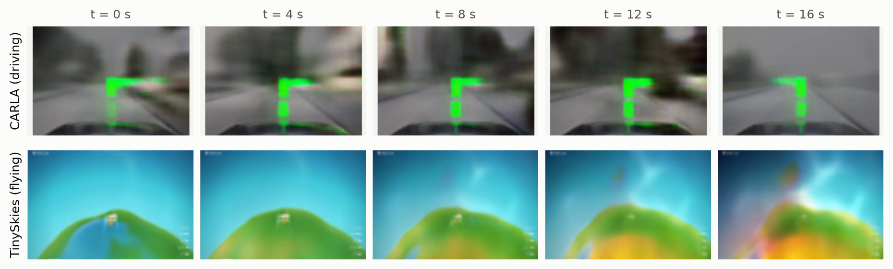
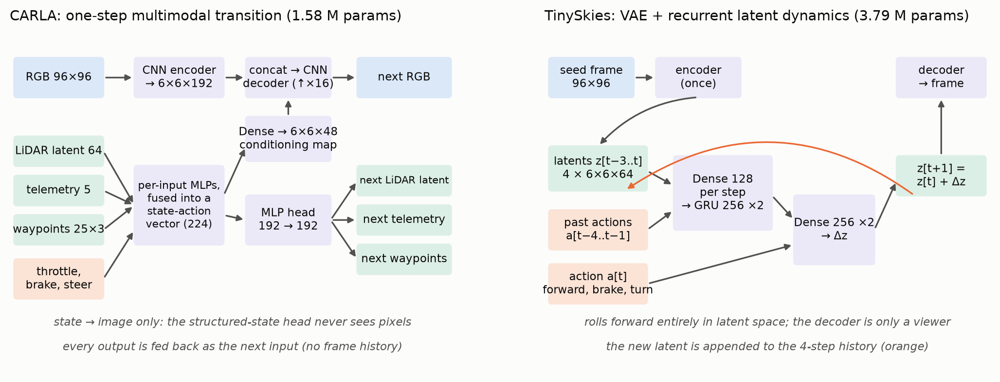
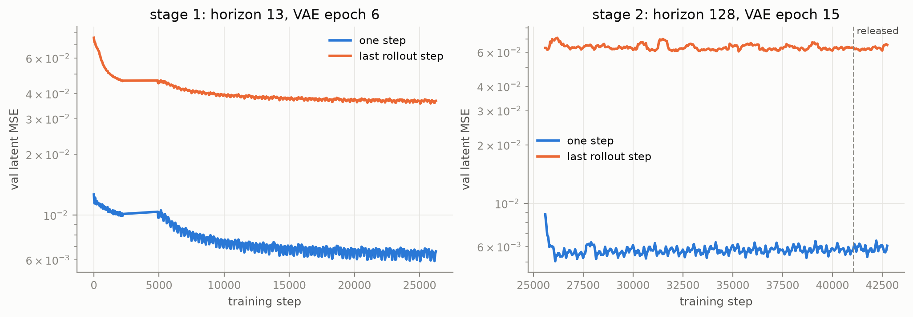
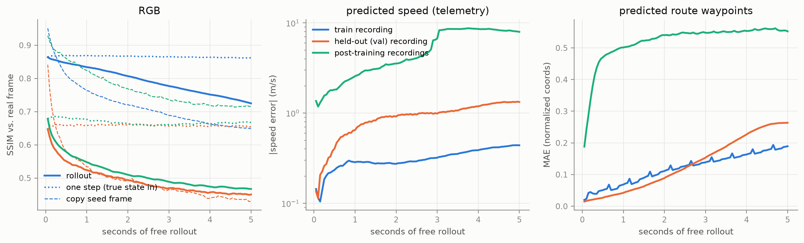
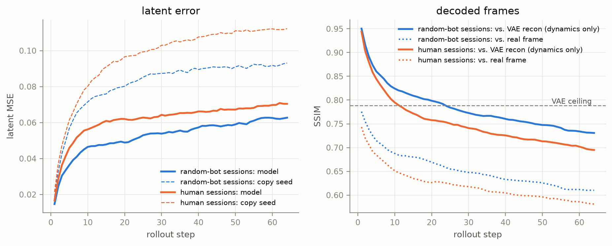
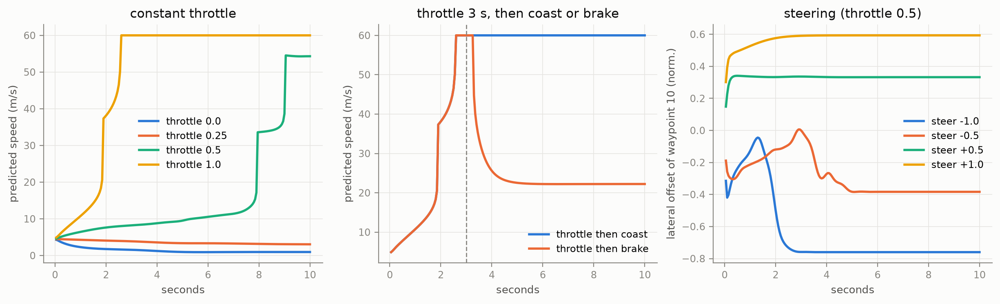
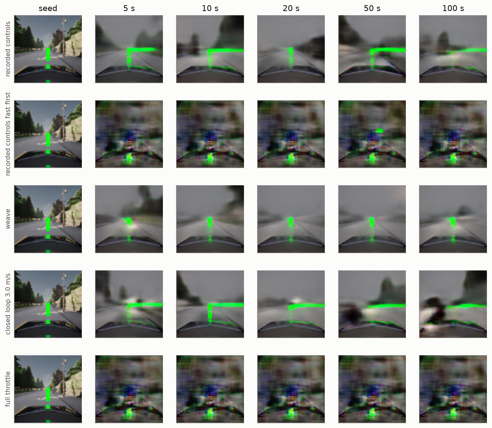
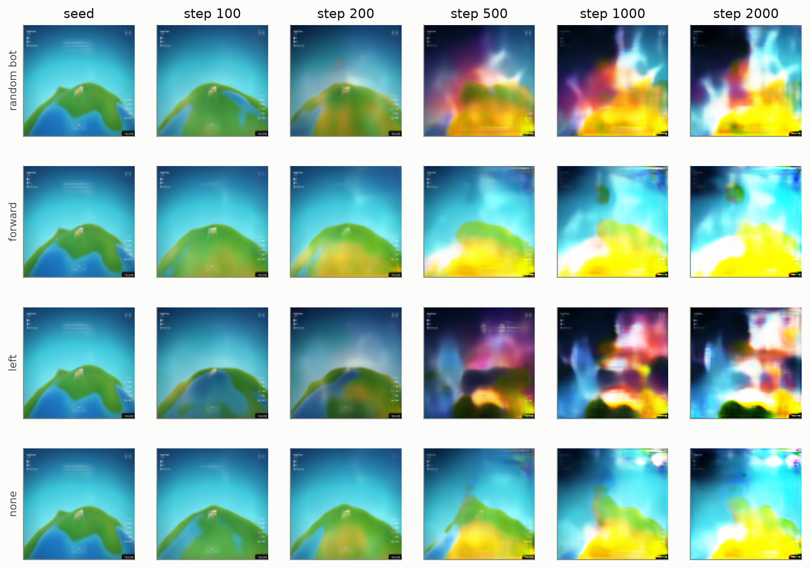

# Neural Simulator: Lightweight World Models for Continuous Interactive Environments

**Jordy Kieto**

*Technical report · Code, models, samples and evaluation: [github.com/JordyKieto/neural-simulators](https://github.com/JordyKieto/neural-simulators) · Live demo: [drift-sim-production.up.railway.app](https://drift-sim-production.up.railway.app/) · Companion report: [Imitation Learning for Autonomous Driving in CARLA](https://github.com/JordyKieto/carla-imitation-learning)*

---

## Abstract

A learned world model can predict the next frame well and still fail as a simulator. Simulation requires the model to consume its own predictions, indefinitely, while an agent or a person keeps changing the actions. We ask how little learned machinery is needed before a model starts to behave like an interactive environment.

We train two deliberately compact action-conditioned transition models on continuous environments:
- **Driving.** A 1.58 M-parameter one-step model of CARLA driving that predicts the next camera frame together with structured state: vehicle telemetry, route waypoints and a LiDAR embedding. It is trained on 3.3 h of autopilot driving.
- **Flight.** A 3.79 M-parameter VAE-plus-GRU latent model of TinySkies, a browser flight game, trained on 1.25 h of screen recordings and keystrokes.

Both run autoregressively under live keyboard control in a web browser, at up to 30 frames per second on a laptop CPU. The source simulator is never executed.

Measured on the released models:
- **Behaviour outlasts appearance.** Coarse behavioural structure survives while visual detail does not. From the first step, CARLA frames keep only 10–33% of the real images' high-frequency detail. Predicted speed on a held-out recording nevertheless stays within ≈1.3 m/s of the truth after 5 s of free rollout.
- **Dynamics live in a small state module.** The CARLA speed, route and momentum dynamics sit in a small state network that never sees pixels. That network behaves as an integrator with little damping: moderate or real autopilot inputs remain bounded for 100 s, but sustained heavy throttle drives it far outside the data and into a visual collapse.
- **Constant inputs lead to fixed points.** Both simulators settle into them. Varied, in-distribution input streams keep them moving.
- **Steering is harder than going straight.** Steering errors are larger than straight-line errors, and the LiDAR embedding is encoded but not carried forward by the learned dynamics.
- **One-step error hides this.** For the flight model, error after 128 self-fed steps is 10.6× its one-step error.

We release both models, the browser demo, the evaluation code and outputs, data samples and a claim-by-claim evidence audit.

---

## 1. Introduction

World models promise learned environments: networks that predict how the world responds to actions well enough to be acted in, by people or by agents [1–4]. Most evidence for that promise takes three forms:
- latent imagination used to train a policy [1, 3];
- offline prediction scored against held-out video [5, 6];
- large generative systems that render convincing interactive frames on datacenter hardware [7–10].

Each form answers a different question from the one a simulator must answer.

**The question here is concrete: can a compact learned model be *entered*?** Concretely, a person presses keys, the model predicts the next state, the prediction becomes the model's next input, and the loop continues for as long as the person keeps playing. That loop is unforgiving. A one-step transition model can reach low prediction error and still be useless as a simulator, because once it consumes its own output its errors change its future inputs. Small visual errors accumulate. Small dynamical errors push the state distribution somewhere the training data never went. **Next-state prediction is the training problem. Sustained neural simulation is the research problem.**

We study this in two continuous environments, chosen because neither has a natural episode end: you can drive around CARLA [11] indefinitely, and fly around the TinySkies globe indefinitely.

The two experiments test the same thesis under different observation regimes:
- **CARLA** is multimodal. The model predicts camera frames and also simulator-style state: speed, acceleration, velocity, the upcoming route and a LiDAR embedding. In principle such a model could serve an autonomous agent as well as a human.
- **TinySkies** removes the privileged state. The model sees only pixels and keystrokes.

Both models are small: 1.6 M and 3.8 M parameters, 6 and 15 MB. Both run client-side in a web browser under continuous human control (Fig. 1). We treat the browser as a scientific instrument, not a deployment target. It turns the world model from a passive predictor into something a person can accelerate, steer, reset, push out of distribution and watch fail, in real time. That makes the learned transition function directly *executable and falsifiable* through interaction.



*Figure 1. Frames captured from the deployed browser demo during scripted keyboard play (20 s each). Every frame is generated by the model from its own previous prediction: 1.58 M parameters for CARLA (top) and 3.79 M for TinySkies (bottom). Neither CARLA nor the game is running.*

**Contributions.**
1. We frame sustained, action-conditioned simulation, rather than short-horizon prediction, as the object of study. We evaluate it with protocols that separate one-step from self-fed error, behaviour from appearance, and open-loop from closed-loop input (§3, §6–7).
2. We test it in two different domains: multimodal driving in CARLA, and visually grounded flight in TinySkies. Both are trained on a few hours of data or less (§4–5).
3. We release both models as directly controllable browser simulations that never execute the source environment, and we measure their size and speed. On one laptop CPU they run at ≈200 and ≈55 steps per second inside a browser tab (§5.3).
4. We characterise where these small models stop behaving like environments:
   - behaviour outlasting appearance;
   - an undamped learned speed integrator;
   - fixed-point attractors under constant input;
   - weaker steering;
   - a LiDAR pathway that is encoded but not propagated.

   We treat these failures as results (§7–8).

**What we do not claim.**
- Neither model reproduces its source environment. There is no traffic, no multi-agent behaviour, no game mechanics, no arbitrary maps.
- The images are low-fidelity and not photorealistic.
- No policy was trained inside either simulator.
- Being able to keep producing frames is not long-horizon stability; §7 shows where that stability ends.
- Browser execution of small world models is not new in itself [12–14]. The combination we study is discussed in §2.

Every claim in this report is graded by its evidence, following the protocol of the companion report [15]:
- **M**: measured, with a released artifact;
- **Q**: qualitatively observed (video, figure);
- **I**: inferred;
- **A**: author-confirmed first-hand observation;
- **U**: unverified.

The full audit is in `paper/CLAIMS.md`.

## 2. Related Work and Positioning

**What kind of world model is this?** Li's functional taxonomy [16] sorts world models by what they output:
- a **renderer** outputs pixels for human eyes and is judged on visual fidelity;
- a **simulator** outputs state that is "geometrically, physically or dynamically faithful" and can be computed on by people and programs;
- a **planner** outputs actions.

Under this taxonomy:
- the TinySkies model is a small action-conditioned **renderer**;
- the CARLA model is a renderer that additionally **exposes simulator-style state** (telemetry and route), but without the physical guarantees that define Li's simulator category.

It is a small instance of the renderer–simulator convergence the essay describes. In survey terms it is an action-conditioned, sequentially simulated, general-purpose world model used as an embodied environment [17, 18]. In the interactive-generative-video decomposition [19] it has Generation (low fidelity), Control (real-time keyboard) and learned Dynamics, minimal Memory, and no Intelligence module.

**Latent world models and model-based RL.** Ha and Schmidhuber's World Models [1] combined a VAE, a recurrent dynamics model and a controller trained inside its own "dream". Their interactive article ran a ≈4.8 M-parameter CarRacing dream in the browser, and the reader could take over with the arrow keys [12]. This is the closest ancestor of our work, conceptually and in deployment, and our TinySkies model follows the same VAE-plus-recurrence decomposition. The PlaNet/Dreamer line [3, 20, 21], MuZero [22], IRIS [23], TWM [38], STORM [39] and DIAMOND [2] optimise world models *as tools for policy learning* and judge them by agent return. We instead treat the human-driven rollout itself as the object of study.

**Action-conditioned video prediction.** Oh et al. [5] and Chiappa et al. [6] predicted Atari and 3D-maze frames conditioned on actions. Chiappa et al. showed that training on the model's own predictions is key to long rollouts. Our CARLA model is structurally a deterministic, Oh/Chiappa-style one-step predictor with an 8-step open-loop loss. Our TinySkies model adds scheduled sampling [24] over a 128-step latent rollout.

**Playable neural games.** GameGAN [25], DriveGAN [26], GameNGen [7], DIAMOND [2], Oasis [8], Genie [27], Genie 2 [40], Genie 3 [9], Muse/WHAM [10] and WHAMM [41] generate playable game worlds. They do so at 10⁸–10¹⁰ parameters, on GPUs or servers, and predict pixels only. Among them, DriveGAN [26] is the closest human-drivable learned driving simulator, trained partly on CARLA and run on a GPU. Recent browser demos show that ≈5 M-parameter learned world models can run client-side in real time [13, 14]. **Compact browser execution is therefore a property of our models, not a novelty claim.**

**Driving world models.**
- Large video models such as GAIA-1/2 [28, 29] and Vista [30] target photorealism.
- In CARLA, MILE [31] and Think2Drive [32] learn latent world models to train or plan driving policies.
- MUVO [33] is trained on CARLA, is conditioned on acceleration and steering, and decodes RGB, LiDAR and 3D occupancy. It is the closest prior work on multimodal CARLA prediction, and it goes further on LiDAR than we do.
- Our CARLA model instead predicts **vehicle telemetry and route waypoints** alongside RGB, at 1.6 M parameters. It carries LiDAR only as an embedding, which §6.4 shows is not propagated.

**Evaluating world models beyond pixels.** Benchmarks such as WorldScore [34] and ACT-Bench [35] score controllability and action-following as well as image quality, and physics-oriented critiques [36] show that visual plausibility is not dynamical correctness. Compounding error under self-feeding is a long-standing problem [24, 37]. Our evaluation follows this move, separating perceptual from behavioural fidelity. It adds one axis that interactive use makes central: **how the input stream itself, open-loop or closed-loop, constant or varied, shapes what the model does.**

**Positioning.** No single system we found combines all five of the following:
1. a sub-5 M-parameter learned transition model;
2. continuous autoregressive rollout;
3. direct real-time human control;
4. predicted non-visual state;
5. client-side browser execution.

Each of these has clear precedents (Table 1). The search scope is documented in `paper/LITERATURE.md` (web and arXiv, through 2026-09-27). To our knowledge, ours is also the first learned CARLA transition model released to run in a browser under continuous keyboard control, and the first learned simulator of TinySkies.

| System | Params | Human real-time | Non-visual state | Runtime | Domain |
|---|---|---|---|---|---|
| World Models, interactive article [1, 12] | ≈4.8 M | yes (override) | no | browser | CarRacing, VizDoom |
| DriveGAN [26] | large | yes | no | GPU | CARLA + real driving |
| MUVO [33] | large | no | LiDAR, occupancy | GPU | CARLA |
| GameNGen / DIAMOND [7, 2] | 10⁸–10⁹ | yes | no | TPU / GPU | DOOM / Atari, CS:GO |
| Oasis, Genie 3, WHAMM [8, 9, 41] | 10⁸–10¹⁰ | yes | no | server | Minecraft, 3D worlds, Quake II |
| Boer Bohan 2025; njkumar 2025 [13, 14] | ≈5 M | yes | no | browser | forest trail; Flappy Bird |
| **Neural Simulator (CARLA)** | **1.6 M** | **yes** | **telemetry, route (+ LiDAR embedding)** | **browser (WASM)** | **CARLA** |
| **Neural Simulator (TinySkies)** | **3.8 M** | **yes** | no | **browser (WASM)** | **TinySkies** |

*Table 1. The combination studied here. Rows summarise published descriptions; see `paper/LITERATURE.md`.*

## 3. Problem Formulation

An environment has state $s_t$, actions $a_t$ and transition $s_{t+1}\sim\mathcal{E}(s_t,a_t)$. A learned transition $f_\theta$ is trained on recorded trajectories $\{(s_t,a_t,s_{t+1})\}$ collected from $\mathcal{E}$ under some behaviour policy $\beta$:

$$\min_\theta\ \mathbb{E}_{(s,a)\sim d_\beta}\ \sum_{k=1}^{H}\ \ell\big(\hat s_{t+k},\,s_{t+k}\big),\qquad \hat s_{t+1}=f_\theta(\hat s_t,a_t),\ \hat s_t=s_t .$$

With $H=1$ this is next-state prediction. With $H>1$ the model is trained on its own predictions for $H$ steps. Deployment, however, is unbounded and closed over a *different* action source $\pi$, here a human:

$$\hat s_{t+1}=f_\theta(\hat s_t,a_t),\qquad a_t\sim\pi(\cdot\mid\hat s_{\le t}),\qquad t=0,1,2,\dots$$

Two distribution shifts compound:
- the state distribution drifts because $\hat s$ is fed back;
- the action distribution differs because $\pi\neq\beta$. A human presses binary keys; the autopilot applied smooth closed-loop control.

The second shift is easy to overlook, and §7 shows it matters as much as the first.

We distinguish two notions of quality:
- **Perceptual fidelity:** how closely generated observations resemble the source environment.
- **Behavioural (dynamical) fidelity:** whether actions cause approximately the right state changes over time.

**Operationally, a learned model "behaves like an environment"** over a horizon if, under the action streams it will actually receive:
- (i) it **responds** to actions in the right direction;
- (ii) it **persists** state such as speed across steps;
- (iii) it **progresses**, i.e. the world keeps moving rather than freezing;
- (iv) it stays **coherent**, i.e. near the distribution of real observations.

§6 measures these properties against real recordings. §7 measures them under scripted, replayed and closed-loop inputs.

## 4. Environments and Data

### 4.1 CARLA driving

**Source.** CARLA 0.9.16 in synchronous mode at 20 Hz, Town01/02, single ego vehicle, no traffic. The data is the same as in the companion imitation-learning report [15]: **448 autopilot recordings, 238,674 frames, 3.32 h** (M).

**Collection.** The route generator enumerates spawn points, queries the road graph for feasible maneuvers, and keeps an autopilot rollout only after verifying that the maneuver was executed [15]. It is released in `carla_sim/collection/`.

**Observations.**
- **RGB:** 224×224 at FOV 90°, resized to 96×96.
- **LiDAR:** 32 channels, 50 m range, binned into a 64×64 bird's-eye-view histogram over 0–30 m ahead and ±10 m laterally, normalised by its maximum bin.
- **Telemetry (5):** tanh-normalised speed (two identical channels), acceleration magnitude, forward velocity and lateral velocity. Speed is recovered as $v = 20\,\mathrm{atanh}(t_0)$ m/s.
- **Waypoints:** 25 route points 2 m apart in the ego frame, each as $(x/d, y/d, d/50)$.
- **Controls:** throttle, brake, steer.

**Distribution** (M):
- 89.5% of windows are labelled straight driving;
- only 9.6% of targets have |steer| > 0.1;
- speeds never exceed 10.0 m/s.

**Privileged inputs.** Telemetry and waypoints come from simulator ground truth and the HD map. During collection the autopilot's route is drawn into the world as green debug markers, so **the markers appear in every recorded camera frame** [15].

**Split.** The training code sorts windows by recording path and uses the first 80% for training. This yields 328 training recordings, 119 validation recordings and one recording split across the boundary (M, reconstructed from the code).

### 4.2 TinySkies flight

**Source.** TinySkies ("GlobeFly") by Danny Limanseta is a publicly available three.js browser game in which a small plane flies around procedurally generated globes. In the game code, W accelerates, S brakes and A/D turn; the plane never stops. We encode actions as $(\text{forward},\text{brake},\text{turn})\in\{0,1\}\times\{0,1\}\times\{-1,0,1\}$.

**Recording.** Playwright drives a Chromium window at 1280×720. It takes a JPEG screenshot each step and logs the key state at the screenshot's midpoint (`tinyskies/record.py`). A bot pressed random combinations of WASD, holding keys for 0.15–1.25 s with at most two held at once.

**Dataset** (M):
- **75 sessions × 60 s, 33,667 frames, 1.25 h;**
- 67 bot sessions and 8 human sessions;
- 62 sessions recorded on the public build and 13 on a local build.

The nominal frame rate was 15 or 20 fps. Because screenshot capture is the bottleneck, the effective rate is **7.5 fps**, with per-session medians of 3.5–14.8 fps. Frame spacing is therefore irregular, a real property of the data. Frames are resized to 96×96. The training split assigns every tenth session to validation, but the order came from a parallel file read, so the exact held-out sessions cannot be reconstructed (see `PROVENANCE.md` §5).

| | CARLA | TinySkies |
|---|---|---|
| Episodes | 448 recordings | 75 sessions |
| Frames / duration | 238,674 / 3.32 h | 33,667 / 1.25 h |
| Rate | 20 Hz, fixed | ≈7.5 fps, irregular |
| Behaviour policy | CARLA autopilot (closed-loop) | random-key bot (67) + human (8) |
| Model inputs | RGB, LiDAR BEV, telemetry, waypoints, controls | RGB, controls |

*Table 2. Datasets (M; `results/dataset/`). Neither is redistributed; samples of both are in `samples/`.*

## 5. Models



*Figure 2. The two simulators. Left: the CARLA model is Markov. Its structured-state head reads only the fused state-action vector, so information flows from state to image and never back. Right: the TinySkies model encodes the seed frame once and then rolls forward entirely in the latent space of a frozen VAE.*

### 5.1 CARLA: one-step multimodal transition model

The model maps $(I_t, z^{L}_t, \tau_t, w_t, a_t)$ to $(I_{t+1}, z^{L}_{t+1}, \tau_{t+1}, w_{t+1})$:
- $I$: RGB image;
- $z^{L}$: 64-d LiDAR embedding;
- $\tau$: telemetry;
- $w$: waypoints;
- $a$: action.

Its structure (Fig. 2, left):
- **Image path.** A four-layer strided CNN encodes the image to 6×6×192.
- **State path.** Small MLPs embed the LiDAR embedding, telemetry, waypoints and action, and concatenate them into a 224-d state-action vector.
- **Conditioning.** That vector is projected to a 6×6×48 map and concatenated with the image features. **This map is the only route by which the action reaches the image.**
- **Image decoder.** Upsamples to the next 96×96 frame, predicted directly rather than as a residual.
- **State head.** A two-layer MLP reading **only the state-action vector** predicts the next LiDAR embedding, telemetry and waypoints.
- **LiDAR encoder.** A three-layer CNN (27 k parameters) turns the seed frame's BEV into $z^L_0$. After the seed, LiDAR exists only as the predicted embedding; **there is no LiDAR decoder**.

The model is deterministic and Markov, with no frame history. Anything that must persist over time has to live in the predicted state.

**Training** (from the training code; `carla_sim/train.py` reproduces it):
- 8-step open-loop rollout loss: after the first step the model consumes only its own predictions;
- RGB loss: L1/MSE plus SSIM plus multiscale and edge terms, weight 1;
- MSE on the LiDAR embedding against the (stop-gradient) encoding of the true future scan, weight 0.25;
- MSE on telemetry and on waypoints, weight 0.25 each;
- Adam, learning rate 10⁻⁴, batch 500.

The configuration also declared scheduled sampling and feedback noise, but the loss never used them.

**Released checkpoint** (M): `world_v3` epoch 20, with 1,551,827 + 27,456 = 1,579,283 trainable parameters. The ONNX files hold 33 more values, which are shape constants.
- Its training history was not recoverable. The logging project exists but holds no runs, and only a screenshot of a later training panel survives (Q).
- We therefore evaluate the released model directly (§6–7) and do not report training curves for it.
- We rebuilt the architecture from the training code, loaded the released weights, and reproduced every output to within 2.4·10⁻⁶ (M, `tools/carla_onnx_to_keras.py`).

### 5.2 TinySkies: VAE and recurrent latent dynamics

**VAE.** A convolutional VAE (1.96 M parameters in training) encodes a 96×96 frame into a **6×6×64 spatial latent** (2,304-d, 12× fewer values than the image). It is trained with L1 reconstruction plus a KL term weighted 10⁻⁵. At runtime only the mean is used.

**Dynamics.** A latent dynamics model (1.84 M parameters) predicts a residual $\Delta z$ with $z_{t+1}=z_t+\Delta z$. Its inputs are the last four latents, the three actions that led into them, and the current action. Its structure: per-step 128-d embeddings, two GRU layers of 256 units, and two 256-unit dense layers (Fig. 2, right). The VAE is frozen. The decoder is only a viewer: the simulator never re-encodes its own output.

**Training** (M, from the exported logs):
- latent MSE plus 0.01‖Δz‖² over a self-fed rollout;
- scheduled sampling with p = 0.1 and Gaussian feedback noise with σ = 0.005;
- Adam, learning rate 3·10⁻⁴, gradient clipping at 1.0.

The released model came from a **two-stage curriculum**:
1. **Stage 1**, epochs 1–28: latents from an early VAE checkpoint (epoch 6), rollout horizon 13.
2. **Stage 2**: resumed from epoch 26 with the final VAE and horizon 128, continuing to epoch 42. **Epoch 40 was released.**

The released VAE holds the weights after 14 completed epochs. Both checkpoints were matched tensor-for-tensor to the deployed files (M, `PROVENANCE.md`).

The training logs already show the paper's central distinction (Fig. 3, Table 3):
- at release, validation error at the last rollout step is **10.6×** the one-step error;
- stage 2 did not reduce either error over 16 further epochs.



*Figure 3. TinySkies latent simulator training: validation latent MSE of the first prediction against the last prediction of the self-fed rollout. The two panels use different latent spaces and horizons, so they are not directly comparable.*

| Stage | Horizon | Val one-step | Val last step | Ratio |
|---|---|---|---|---|
| 1 (epochs 27–28) | 13 | 0.0065 | 0.0368 | 5.7× |
| 2 (epochs 41–42) | 128 | 0.0059 | 0.0632 | 10.8× |
| **Released (epoch 40)** | 128 | **0.0059** | **0.0625** | **10.6×** |

*Table 3. TinySkies training-log metrics (M; `results/training_curves.ipynb`).*

### 5.3 Browser runtime, size and speed

**Runtime.**
- Both models are exported to ONNX (fp32, opset 17) and run with onnxruntime-web 1.22 on the WASM backend, entirely client-side.
- A 30 fps loop reads the keyboard, runs one step, draws the frame and feeds all predicted outputs back.
- Driving controls ramp over 0.5 s, because keyboard input is binary.
- The demo re-seeds after 500 generated frames.

**Simulated time runs faster than real time.** At 30 fps the demo advances CARLA's 20 Hz dynamics about 1.5× faster than real time, and TinySkies' ≈7.5 fps dynamics about 4× faster.

| | CARLA | TinySkies |
|---|---|---|
| Parameters at runtime (trainable) | 1,579,283 | 3,785,443 |
| Size (fp32 ONNX) | 6.4 MB | 15.2 MB |
| Step, browser WASM, 4 threads | **5.0 ms** (≈200 steps/s) | **18.3 ms** (≈55 steps/s) |
| Step, browser WASM, 1 thread | 11.7 ms | 47.5 ms |
| Step, Python onnxruntime, 1 / 4 threads | 6.1 / 2.6 ms | 23.7 / 15.6 ms |
| Latent dynamics only (no decoding), 1 / 4 threads | — | 0.50 / 0.35 ms |

*Table 4. Size and closed-loop latency, batch 1, Apple M1 laptop CPU (M; `results/latency.ipynb`). The browser benchmark runs the same onnxruntime-web version as the demo in headless Chromium.*

On one laptop CPU inside a browser tab, both simulators run faster than their data's native rate (Table 4).
- **Where TinySkies spends its time.** Its world model costs half a millisecond per step; decoding the latent into pixels takes the remaining ≈98% of step time.
- **WebGPU.** It runs the CARLA model but fails on the GRU's `Split` kernel in onnxruntime-web 1.22, so the demo uses WASM.
- **The live demo.** Its own performance readout, logged while the frames in Fig. 1 were captured with screen recording running, showed a median of 29 fps at 8.9 ms per step for driving and 24 fps at 37 ms per step for flying (Q).

## 6. Offline Evaluation: One-Step Prediction versus Sustained Rollout

**Protocol.**
1. Start from a real recorded state.
2. Apply the *recorded* actions.
3. Let the model consume only its own predictions for $H$ steps.
4. Compare every step with the real recording.

**Two references.**
- **One-step:** the model is given the true state at every step, i.e. the metric a training loss usually reports.
- **Copy:** hold the seed frame, i.e. a model that predicts no change.

**Evaluation sets.**
- **CARLA:** four locally available recordings with 100-step (5 s) rollouts started every 10 frames:
  - one training recording (40 rollouts);
  - one held-out validation recording (30 rollouts);
  - two recordings made after training with a different driving style (60 rollouts).
- **TinySkies:** 14 sessions (every tenth session plus all eight human sessions) with 64-step rollouts (≈8.5 s at the data rate), seeded with four real frames. These sessions may overlap training data, so we report them as *possibly seen*.

### 6.1 CARLA: appearance degrades from the first step; behaviour degrades slowly



*Figure 4. CARLA replay. Left: SSIM of rollout, one-step and copy predictions. Middle: absolute error of predicted speed (log scale). Right: waypoint error. Horizontal axes are seconds of free rollout.*

| Recording | Horizon | SSIM rollout | SSIM one-step | SSIM copy | True speed | Speed error | Detail kept (pred/true) |
|---|---|---|---|---|---|---|---|
| train | 1 step | 0.86 | 0.86 | 0.95 | 3.2 m/s | 0.14 m/s | 0.31 |
| train | 5 s | 0.72 | 0.86 | 0.65 | 3.3 m/s | 0.44 m/s | 0.33 |
| held-out | 1 step | 0.65 | 0.65 | 0.84 | 7.2 m/s | 0.14 m/s | 0.12 |
| held-out | 5 s | 0.45 | 0.65 | 0.43 | 5.6 m/s | 1.33 m/s | 0.10 |
| post-training | 1 step | 0.68 | 0.68 | 0.93 | 1.0 m/s | 1.36 m/s | 0.11 |
| post-training | 5 s | 0.47 | 0.67 | 0.72 | 0.8 m/s | 7.96 m/s | 0.17 |

*Table 5. CARLA replay (M; `results/rollout_eval.ipynb`). "Detail kept" is the ratio of the Laplacian variance of predicted frames to that of real frames.*

**Detail is never reconstructed, even at step 1.** Predicted frames carry 10–33% of the real frames' high-frequency detail from the first step, and that ratio stays flat over the horizon (Table 5, last column; M). Fine structure (vegetation, texture, distant geometry) is not reconstructed and then forgotten; the model never reconstructs it. What it renders is coarse layout: road, horizon, hood, blob-like trees and buildings, and, notably, the green route markers from data collection, which it continues to draw and move as the route turns (Q; `results/figures/carla_long_snapshots.png`).

**In pixels, the model beats "no change" only on the training recording.**
- On the training recording it overtakes the copy baseline after 0.3 s (6 steps) and stays above it for the rest of the 5 s.
- On the held-out recording it is roughly equal to copy throughout.
- On the post-training recordings, which include slow, off-route driving never seen in training, it is worse than copy at every horizon.

Pixel similarity rewards predicting stillness, and these recordings are mostly slow.

**Behaviour degrades far more slowly than appearance where the data supports it.** On the held-out recording, predicted speed after 5 s is within 1.3 m/s of the truth, at speeds of 5–7 m/s (M). The one-step SSIM is flat over the horizon while the rollout SSIM falls: **the gap between them is the compounding error** that a one-step metric does not see. On the post-training recordings speed error grows to ≈8 m/s. These are out-of-distribution states, and the model also fails behaviourally there.

**Turning is harder than going straight** (M; `carla_turning_table.csv`). Compared with steps whose recorded |steer| ≤ 0.1, steps with recorded |steer| > 0.1 have:
- 1.3–1.6× the speed error at 0.5–2 s;
- 1.8–1.9× the waypoint error at 0.5–2 s;
- 5× the speed error at 5 s.

RGB similarity is almost unaffected. The turning deficit is in the dynamics, not in appearance.

### 6.2 CARLA: which inputs does the model use?

We replaced one input at a time with the same input from another real frame and measured how much each output changed (M; `eval/carla_sensitivity.py`, 512 real states).

| Shuffled input | Δ next RGB | Δ next telemetry | Δ next waypoints | Δ next LiDAR emb. |
|---|---|---|---|---|
| RGB | 0.105 | **0.000** | **0.000** | **0.000** |
| telemetry | 0.003 | **0.116** | 0.016 | 0.014 |
| waypoints | 0.011 | 0.081 | **0.294** | 0.050 |
| controls | 0.007 | 0.057 | 0.045 | 0.041 |
| LiDAR embedding | 0.00002 | 0.0003 | 0.0003 | 0.0004 |

*Table 6. Mean absolute change of each output when one input is taken from a different real frame.*

Two structural facts follow. Neither is visible in pixel metrics.

**1. Information flows from state to image, never back.** Shuffling the image leaves every structured output exactly unchanged, because the state head never sees pixels. The CARLA simulator is therefore two models in one:
- a ≈0.1 M-parameter state-and-action dynamics network, which carries speed, route and momentum;
- an image generator conditioned on that state.

This is the mechanism behind the central qualitative observation: **momentum and progression survive while pixels blur**, because they are computed in a pathway that pixel errors cannot corrupt.

**2. Actions move the state more than the image.** Controls change telemetry and waypoints 6–8× more than they change the image. A full-lock steer changes the next frame by 0.03 and the next waypoints by 0.15 (`sensitivity.json`, M). The image responds to actions mostly *through* the state it renders.

### 6.3 TinySkies: latent dynamics beat stillness; the VAE bounds appearance



*Figure 5. TinySkies replay. Left: latent error of the model and of holding the seed latent. Right: SSIM of decoded predictions against the real frame (dotted) and against the VAE reconstruction of the real frame (solid; dynamics only). The dashed line is the VAE's own reconstruction quality.*

| | Latent MSE | Latent MSE (copy) | SSIM vs real | SSIM vs VAE recon (dynamics only) |
|---|---|---|---|---|
| VAE ceiling (no dynamics) | — | — | 0.789 | — |
| step 1 | 0.016 | 0.020 | 0.757 | 0.947 |
| step 8 | 0.049 | 0.072 | 0.677 | 0.822 |
| step 32 | 0.060 | 0.097 | 0.628 | 0.751 |
| step 64 (≈8.5 s) | 0.067 | 0.104 | 0.593 | 0.710 |

*Table 7. TinySkies replay over 14 sessions possibly seen in training (M).*

**The model's latent error stays below the copy baseline at every horizon** (Table 7). That is: it predicts how the view changes under the recorded keys better than predicting no change, for the full 64 steps.

**Appearance is bounded by the VAE, not by the dynamics.** The VAE alone reaches SSIM 0.79 and keeps 35% of the real frames' fine detail. Measured against VAE reconstructions, which removes reconstruction error, the dynamics lose SSIM gradually, from 0.95 after one step to 0.71 after 64.

**Turning is not harder here, unlike in CARLA.** Turning steps have slightly *lower* latent error than straight ones. Sessions flown by a human are modestly harder than bot sessions: latent MSE at step 64 is 0.070 against 0.063.

### 6.4 CARLA: LiDAR is encoded but not propagated

The training LiDAR loss stayed close to zero, which could suggest that the LiDAR embedding was learned well. We tested this directly (M; `eval/carla_lidar_probe.py`, 1,700 real scans).

- **Encoded.** The seed embedding does contain scan information. On standardized embeddings, ridge probes predict a scan's occupied-cell count with held-out R² = 0.80 and its left/right asymmetry with R² = 0.77. The same probes on the pooled raw scan reach 0.89 and 0.96.
- **Squeezed.** Two real scans differ by 129% of a scan's mean magnitude, but their embeddings differ by only 0.17%. A predictor that always outputs the mean embedding would score an MSE of **8·10⁻⁶** against the training target. A near-zero LiDAR loss is therefore reachable without any learning, and at weight 0.25 it contributes almost no training signal.
- **Not propagated.** One step ahead, the model's predicted embedding misses the true future embedding by ≈2,300 standard deviations of the embedding's natural variation. Its per-dimension correlation with the truth is 0.03 at step 1 and ≈0 afterwards. Consistent with Table 6, the other outputs are insensitive to it.

The released CARLA model is therefore multimodal in its *inputs* at the seed and in its *structured outputs* (telemetry and route), but not in LiDAR dynamics. **We describe it as predicting RGB plus structured state (telemetry and route), with a LiDAR embedding carried through the loop.** We do not say that it predicts LiDAR. This is a concrete example of a low auxiliary loss that says nothing about whether a modality was learned.

## 7. Interactive Behaviour: What the Learned Environments Capture

§6 fixed the actions to the recorded ones. In interactive use the actions come from somewhere else. This section drives the released models with scripted inputs (constant levels, oscillation), open-loop replays of real autopilot control streams, and a simple closed-loop controller, over 2,000 steps. For CARLA that is 100 s of simulated time from each of the six browser seeds. For TinySkies it is 2,000 steps from each of the nine browser seed frames.

### 7.1 CARLA: control response and momentum



*Figure 6. CARLA action response from the six browser seeds (mean). Left: constant throttle. Middle: full throttle for 3 s, then coast or brake. Right: lateral offset of the predicted route under constant steering. Speed is clipped at 60 m/s for display.*

**Response (i).** Every control moves the state in the right direction (M).
- Throttle raises predicted speed and brake lowers it.
- Steering left moves the predicted route and lateral velocity to the left, and steering right moves them to the right. For waypoint 10, the lateral offset is −0.76 for steer −1 and +0.59 for steer +1.

**Persistence (ii).** Speed persists across steps instead of resetting each frame (M).
- Constant low throttle settles at a stable speed: ≈1 m/s with none, ≈3.1 m/s at 0.25.
- After 3 s of full throttle, releasing the pedal leaves speed high while braking lowers it.

This is the learned momentum that the author observed while driving, with acceleration changing how fast the world streams past (A). Our pixel metric supports that observation only weakly. Over the first 3 s, the mean change between consecutive frames is 0.0017 at idle and 0.0019 at throttle 0.5, and only doubles (0.0034) at full throttle, where predicted speed is already out of distribution (M). Mean absolute pixel change on blurred frames may understate apparent motion. A flow-based measure is future work.

**The integrator has too little damping.** Sustained throttle of 0.75 or more drives predicted speed beyond the 10 m/s maximum present in the data and on to the saturation point of the telemetry encoding in all six seeds. At 0.5 this happens in two of six seeds (M). Median time to saturation is 2.75 s at full throttle. The same happens under constant left steer (2.55 s), but not under right steer, an asymmetry with no counterpart in the data. Braking from saturation brings speed down only to ≈22 m/s. The learned speed dynamics integrate throttle but never learned the drag and speed limit that the autopilot's closed-loop control made unnecessary to observe: in the data, the autopilot eased off before speed ever got high.

### 7.2 Long rollouts: the input stream decides

| Input stream (100 s) | Speed at 100 s (median seed) | Seeds saturating speed | Seeds frozen, last 10 s |
|---|---|---|---|
| Replayed autopilot controls (slow-first stream) | 2.3 m/s | 0/6 | **0/6** |
| Replayed autopilot controls (fast-first stream) | saturated | 4/6 | 0/6 |
| Weave (steer ±0.5, sinusoid, throttle 0.5) | 7.4 m/s | 0/6 | **0/6** |
| Constant throttle 0.5 | 5.0 m/s | 2/6 | 4/6 |
| Constant full throttle | saturated | 6/6 | 0/6 (noise attractor) |
| Constant idle | 1.0 m/s | 0/6 | 5/6 |
| Constant left 0.5 / right 0.5 | saturated / 3.1 m/s | 6/6 / 0/6 | 6/6 / 0/6 |
| Closed-loop controller, target 3 / 5 / 7 m/s | 3.0 / 3.4 / 4.6 m/s | 0/6 | 5/6 / 6/6 / 6/6 |

*Table 8. CARLA long rollouts (M; `carla_long_table.csv`). "Frozen" means the mean absolute change between consecutive frames is below 10⁻³.*



*Figure 7. CARLA long rollouts from one held-out seed, snapshots at 5, 10, 20, 50 and 100 s. From the top: replayed autopilot controls (slow-first and fast-first streams), weave, closed-loop controller at 3 m/s, constant full throttle.*

Three regimes appear (Table 8, Fig. 7; M).

**1. Varied, in-distribution inputs sustain simulation for the full 100 s.** Replaying real autopilot control sequences open-loop keeps all six seeds bounded (median 2.3 m/s) and moving (0/6 frozen), with road, route markers and turns still being rendered after 100 s. An oscillating steering input does the same. This is the regime a careful human driver is in (A).

**2. Constant inputs converge to fixed points.** Constant idle, cruise or left steer each settle into a static frame (frame change → 0), even when the predicted state says the car is moving. At that point the image has decoupled from the state.

**3. Out-of-distribution inputs collapse.** Sustained full throttle, or a control stream from the faster held-out recording, saturates speed within ≈3–5 s. Four to six of six seeds then fall into the same noise-textured image, a shared attractor that is unrelated to the seed. The live demo reaches it too when the throttle key is held (Q; `assets/driving_runaway.gif`).

**Closing the loop on the model's own state.** A 10-line controller reads only the *predicted* speed and waypoints: proportional throttle toward a target speed, plus steering toward waypoint 5.
- It keeps speed bounded for 100 s in every seed. Driving to 3, 5 and 7 m/s targets ends at 3.0, 3.4 and 4.6 m/s, with 0/6 saturations.
- It never enters the noise attractor.

Two conclusions follow.
- **The predicted structured state is usable for control.** An agent reading only the simulator's outputs can regulate it (M). This supports, in a minimal form, the idea that the CARLA model could serve as an agent environment. We do not claim that a learned policy would transfer.
- **Feedback is not enough on its own.** The controller settles to near-constant actions, and the image then freezes: 5–6 of 6 seeds by 100 s. It also under-shoots higher targets, because it steers persistently toward rendered turn markers.

Interactive use succeeds in the regime between these failures: a person who varies their inputs and eases off when the world rushes by.

### 7.3 TinySkies: terrain evolves, forward flight stalls



*Figure 8. TinySkies long rollouts from one browser seed, snapshots at steps 100, 200, 500, 1,000 and 2,000. From the top: random-key bot, constant forward, constant left, no input.*

**What survives.** Over the first 100–200 steps (≈3–7 s at 30 fps in the browser), the learned world does what the author observed in play (A; Fig. 1, Fig. 8):
- terrain evolves as the plane moves;
- biomes shift from green to yellow, ocean regions come and go, and the horizon arc persists;
- the plane sprite stays visible.

This is the core motion competence and environmental progression that the VAE latent can express. The game's interface elements, balloons, collectibles and tricks are not reproduced (A).

**Fixed points and dissolution.** With a constant forward, brake or no-input stream, all nine seeds converge to a static frame by 2,000 steps. The plane appears to stop, which the real game never does (M). Constant turning keeps the world moving indefinitely (0–1 of 9 frozen): the view keeps rotating. Beyond ≈500 steps, the globe's structure dissolves into saturated colour fields under every input (Q). As in CARLA, the input stream determines whether the simulator keeps progressing.

## 8. Failure Analysis

These failures define the result. We report them per environment, without forcing symmetry between the two.

**CARLA.**
- **Steering and geometry.** Steering errors in the dynamics are 1.3–5× larger than straight-line errors (§6.1). Steering left, but not right, drives speed to saturation (§7.1). The data is 89.5% straight driving. The author observed that turning and large steering interventions expose weak geometry, while forward driving is the model's strongest regime (A).
- **Appearance.**
  - Fine detail is never reconstructed; vegetation and texture are imagined, not recalled (Q, M).
  - Geometry drifts over long rollouts (Q).
  - The model renders the route markers that collection drew into the camera frames. Its image is partly a rendering of its own predicted route.
- **Undamped speed.** Speed is integrated with too little damping (§7.1). Keyboard throttle is binary, so the demo ramps it, and holding the key still leads to runaway and collapse.
- **Fixed points under constant input** (§7.2).
- **LiDAR** is encoded but not propagated (§6.4).
- **Scope.** There are no other agents, traffic rules, collisions or map changes. The model is bounded by the distribution of 448 autopilot recordings on two towns. Its inputs include privileged simulator state.

**TinySkies.**
- **Fidelity** is bounded by a 12×-compressing VAE (SSIM 0.79, 35% of fine detail).
- **Forward flight** decays to a static frame under constant input (§7.3).
- **Structure** of the globe dissolves after ≈500 steps.
- **Game features** such as UI, collectibles and tricks are absent.
- **Timing.** The training data's irregular ≈7.5 fps timing means one model step is not a fixed amount of game time.

**Both.**
- **What compact models learn first.** Coarse motion, progression and momentum come first. Precise geometry, fine appearance and saturation behaviour come last. Behaviour survives longer than appearance (CARLA) or than latent structure (TinySkies).
- **Action-stream sensitivity.** The deployment action distribution matters as much as the state drift that one-step metrics ignore. Constant inputs expose fixed points. Out-of-distribution inputs expose missing physics.

## 9. Discussion

**Perceptual versus behavioural fidelity.** The CARLA model keeps a third or less of the real images' detail, yet it tracks speed on held-out driving, moves its route in the commanded direction, and sustains 100 s of coherent driving under realistic input streams. Its architecture makes the separation explicit: the dynamics that carry behaviour never see pixels. **How much visual fidelity a learned environment needs depends on what it is for.** For a human who wants to feel momentum and progression, very little. For an agent that must act on images, far more. The CARLA model exposes structured state an agent could use, and §7.2 shows that even a hand-written controller can read and regulate that state. We do not claim that this is sufficient for policy learning. RGB fidelity and the speed runaway are the practical reasons we did not attempt training a policy inside the simulator in this iteration.

**The browser as an instrument.** Interaction exposed every failure in §8 before any metric did. Holding a key triggers the speed runaway. Steering reveals the weak geometry. Watching long enough reveals fixed points. Offline replay with recorded actions shows none of these, because the recorded actions come from the same closed-loop controller that produced the data. **The action stream is part of the test.** A simulator should be evaluated under the inputs it will actually receive, and a browser is the cheapest way to hand those inputs to a person. The same models also run at ≈50–200 steps per second on a laptop CPU, so the instrument costs nothing to run.

**Why small models behave this way.** With a Markov state and a deterministic transition, a constant input makes the rollout the iteration of a fixed map, and iterated maps tend to converge to fixed points or small cycles. Varied inputs keep perturbing the map. The speed runaway is the same property seen through the data: the autopilot never held the throttle down, so nothing in training constrained what happens when someone does.

## 10. Limitations and Threats to Validity

- **Small evaluation sets.**
  - CARLA replay uses four locally available recordings: one training, one held-out, two post-training.
  - The TinySkies sessions may overlap the training set (§6).
  - Long-rollout results come from six CARLA and nine TinySkies seeds.
- **Missing training history.** The CARLA model's training history was not recoverable. Every CARLA number comes from evaluating the released model.
- **Qualitative observations.** Observations from human interaction are author-reported (A) or qualitative (Q), not systematic user studies.
- **Metric choices.** "Frozen" and "saturated" are threshold definitions; see the notebook for continuous values. SSIM rewards stillness, so we pair it with behavioural metrics throughout.
- **Privileged inputs.** CARLA inputs include privileged telemetry and HD-map route waypoints, and the camera frames contain drawn route markers.
- **Time mismatch.** Simulated time in the demo runs faster than real time (§5.3).
- **Measurement platform.** Latency was measured on one machine (Apple M1).

## 11. Future Work

- **Multimodal training.** Make LiDAR a first-class predicted modality, with a decoder and a loss that cannot be satisfied by a constant, and measure whether it propagates. RGB was the first evidence of viability; structured prediction is the goal.
- **Better dynamics.**
  - Add frame history or recurrence to the CARLA model.
  - Add damping and speed saturation through data (non-autopilot, high-speed and recovery driving) or through structure.
  - Use turn-balanced data.
- **Agents in the loop.**
  - Train a policy inside the CARLA simulator on its structured outputs and measure transfer back to CARLA.
  - The companion report's driving policy is a natural first agent.
- **Behavioural benchmarks.**
  - Standardise the input-stream conditions of §7 (replayed, constant, closed-loop, human) as an evaluation protocol for interactive world models.
  - Run a controlled user study in the browser.

## 12. Conclusion

A world model becomes more interesting when its predictions can be acted on, when those actions change the next predictions, and when the loop stays coherent long enough to count as an environment. Two compact models, 1.6 M and 3.8 M parameters, cross into that regime:
- a person can drive through learned CARLA dynamics and fly over a learned TinySkies globe in a web browser;
- speed, momentum, route and terrain progression respond to their inputs.

They also show where the regime ends: fine appearance first, then geometry, then the physics the training data never needed to show, with constant inputs driving both into fixed points. The learned environments are not replicas of their sources. They are compact approximations of particular slices of dynamics, and they can be entered, controlled, observed, broken and studied. The longer-term aim is not better neural video but learned environments structured, efficient and dynamically faithful enough to be places where people and agents act.

---

## Appendix A. Artifact provenance

`PROVENANCE.md` traces every released file to its training run and epoch, and every dataset statistic to its source.

**Models.**
- The CARLA model is `world_v3` epoch 20. Its architecture is verified by output parity (≤2.4·10⁻⁶).
- The TinySkies models are VAE (14 epochs) and latent simulator epoch 40. They are verified tensor-for-tensor against the deployed files, with a negative control that does not match.
- The deployed ONNX files are byte-identical to `artifacts/`.

**Training logs.** TinySkies training logs are exported to `results/<run_id>/`. The paper does not link to external logging services.

## Appendix B. Model lineage

**CARLA.**

| Version | What it was | Status |
|---|---|---|
| v1 | 64×64 diffusion-style world model | not released |
| v2 | history-4, horizon-8 predictor | not released |
| **v3** | **this report** | released |
| v4 | latent transition on a frozen RGB autoencoder, 128-step rollout loss, ≈4.0 M parameters; trained to epoch 5 | not deployed; future work |

**TinySkies.**
- Pixel-space residual predictors (v1/v2).
- A VAE-plus-transformer open-loop 16-step predictor (v3).
- VAEs with dense 128-d and 1,280-d latents, replaced by the 6×6×64 spatial latent.
- A transformer latent simulator, replaced after one epoch by the released GRU.

## Appendix C. Reproducibility

```bash
python eval/carla_eval.py --recordings <processed CARLA recordings>
python eval/carla_sensitivity.py --recordings <...>
python eval/carla_lidar_probe.py --recordings <...>
python eval/tinyskies_eval.py --processed <processed TinySkies sessions>
python eval/latency.py; (cd eval/browser_bench && npm install && node run.mjs)
python tools/build_notebooks.py    # results/*.ipynb and results/figures/
python paper/make_figures.py       # paper/figures/
```

Every trainer has a `--smoke` mode that runs on `samples/`.

---

## References

[1] D. Ha and J. Schmidhuber. World Models. arXiv:1803.10122, 2018 (NeurIPS 2018 version: "Recurrent World Models Facilitate Policy Evolution", arXiv:1809.01999).
[2] E. Alonso, A. Jelley, V. Micheli, A. Kanervisto, A. Storkey, T. Pearce, F. Fleuret. Diffusion for World Modeling: Visual Details Matter in Atari (DIAMOND). NeurIPS 2024. arXiv:2405.12399.
[3] D. Hafner, J. Pasukonis, J. Ba, T. Lillicrap. Mastering Diverse Control Tasks through World Models (DreamerV3). *Nature* 640, 2025. arXiv:2301.04104.
[4] D. Hafner, W. Yan, T. Lillicrap. Training Agents Inside of Scalable World Models (Dreamer 4). arXiv:2509.24527, 2025.
[5] J. Oh, X. Guo, H. Lee, R. Lewis, S. Singh. Action-Conditional Video Prediction using Deep Networks in Atari Games. NeurIPS 2015. arXiv:1507.08750.
[6] S. Chiappa, S. Racanière, D. Wierstra, S. Mohamed. Recurrent Environment Simulators. ICLR 2017. arXiv:1704.02254.
[7] D. Valevski, Y. Leviathan, M. Arar, S. Fruchter. Diffusion Models Are Real-Time Game Engines (GameNGen). ICLR 2025. arXiv:2408.14837.
[8] Decart and Etched. Oasis: A Universe in a Transformer. https://oasis-model.github.io, 2024.
[9] J. Parker-Holder, S. Fruchter, et al. Genie 3: A New Frontier for World Models. Google DeepMind blog, 2025.
[10] A. Kanervisto et al. World and Human Action Models towards Gameplay Ideation (Muse/WHAM). *Nature* 638, 2025.
[11] A. Dosovitskiy, G. Ros, F. Codevilla, A. López, V. Koltun. CARLA: An Open Urban Driving Simulator. CoRL 2017.
[12] D. Ha and J. Schmidhuber. World Models (interactive article). https://worldmodels.github.io, 2018.
[13] O. Boer Bohan. World Emulation via Neural Network. https://madebyoll.in/posts/world_emulation_via_dnn/, 2025.
[14] N. Kumar. Optimizing a Flappy Bird World Model to Run in a Web Browser. https://www.njkumar.com/optimizing-flappy-bird-world-model-to-run-in-a-web-browser/, 2025.
[15] J. Kieto. Imitation Learning for Autonomous Driving in CARLA. Technical report, 2026. https://github.com/JordyKieto/carla-imitation-learning.
[16] F.-F. Li. A Functional Taxonomy of World Models. https://drfeifei.substack.com/p/a-functional-taxonomy-of-world-models, 3 June 2026.
[17] J. Ding et al. Understanding World or Predicting Future? A Comprehensive Survey of World Models. arXiv:2411.14499, 2024.
[18] X. Li et al. A Comprehensive Survey on World Models for Embodied AI. arXiv:2510.16732, 2025.
[19] J. Yu et al. A Survey of Interactive Generative Video. arXiv:2504.21853, 2025.
[20] D. Hafner et al. Learning Latent Dynamics for Planning from Pixels (PlaNet). ICML 2019. arXiv:1811.04551.
[21] D. Hafner, T. Lillicrap, J. Ba, M. Norouzi. Dream to Control: Learning Behaviors by Latent Imagination. ICLR 2020. arXiv:1912.01603.
[22] J. Schrittwieser et al. Mastering Atari, Go, Chess and Shogi by Planning with a Learned Model (MuZero). *Nature* 588, 2020. arXiv:1911.08265.
[23] V. Micheli, E. Alonso, F. Fleuret. Transformers are Sample-Efficient World Models (IRIS). ICLR 2023. arXiv:2209.00588.
[24] S. Bengio, O. Vinyals, N. Jaitly, N. Shazeer. Scheduled Sampling for Sequence Prediction with Recurrent Neural Networks. NeurIPS 2015. arXiv:1506.03099.
[25] S. W. Kim, Y. Zhou, J. Philion, A. Torralba, S. Fidler. Learning to Simulate Dynamic Environments with GameGAN. CVPR 2020. arXiv:2005.12126.
[26] S. W. Kim, J. Philion, A. Torralba, S. Fidler. DriveGAN: Towards a Controllable High-Quality Neural Simulation. CVPR 2021. arXiv:2104.15060.
[27] J. Bruce et al. Genie: Generative Interactive Environments. ICML 2024. arXiv:2402.15391.
[28] A. Hu et al. GAIA-1: A Generative World Model for Autonomous Driving. arXiv:2309.17080, 2023.
[29] L. Russell et al. GAIA-2: A Controllable Multi-View Generative World Model for Autonomous Driving. arXiv:2503.20523, 2025.
[30] S. Gao et al. Vista: A Generalizable Driving World Model with High Fidelity and Versatile Controllability. NeurIPS 2024. arXiv:2405.17398.
[31] A. Hu et al. Model-Based Imitation Learning for Urban Driving (MILE). NeurIPS 2022. arXiv:2210.07729.
[32] Q. Li, X. Jia, S. Wang, J. Yan. Think2Drive: Efficient Reinforcement Learning by Thinking in Latent World Model for Quasi-Realistic Autonomous Driving (in CARLA-v2). ECCV 2024. arXiv:2402.16720.
[33] D. Bogdoll, Y. Yang, T. Joseph, M. Zöllner. MUVO: A Multimodal World Model with Spatial Representations for Autonomous Driving. IV 2025. arXiv:2311.11762.
[34] H. Duan, H.-X. Yu, S. Chen, L. Fei-Fei, J. Wu. WorldScore: A Unified Evaluation Benchmark for World Generation. ICCV 2025. arXiv:2504.00983.
[35] H. Arai et al. ACT-Bench: Towards Action Controllable World Models for Autonomous Driving. arXiv:2412.05337, 2024.
[36] B. Kang et al. How Far is Video Generation from World Model: A Physical Law Perspective. ICML 2025. arXiv:2411.02385.
[37] E. Talvitie. Self-Correcting Models for Model-Based Reinforcement Learning. AAAI 2017. arXiv:1612.06018.
[38] J. Robine, M. Höftmann, T. Uelwer, S. Harmeling. Transformer-based World Models Are Happy With 100k Interactions (TWM). ICLR 2023. arXiv:2303.07109.
[39] W. Zhang, G. Wang, J. Sun, Y. Yuan, G. Huang. STORM: Efficient Stochastic Transformer based World Models for Reinforcement Learning. NeurIPS 2023. arXiv:2310.09615.
[40] Google DeepMind. Genie 2: A Large-Scale Foundation World Model. Blog post, 4 December 2024.
[41] Microsoft Research. WHAMM: Real-time world modelling of interactive environments (Quake II in Copilot Labs). Blog post, 4 April 2025.
